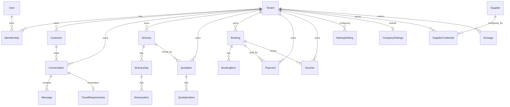

# Database Schema

Source of truth: `prisma/schema.prisma`; migrations in `prisma/migrations`.

## Tenancy

## Tenant-owned tables (carry `tenantId`)

Customer, Conversation, Itinerary, Quotation, Booking, Payment, Voucher, MarkupSetting, CompanySettings (unique per tenant), SupplierCredential (unique per tenant + supplier), AiUsage. `AuditLog.tenantId` is nullable for platform-level events.

Child tables without `tenantId` (Message, TravelRequirements, ItineraryDay, ItineraryItem, QuotationItem, BookingItem, Refund) must only be reached through a tenant-scoped parent that was verified first. Global: Tenant, User, Membership, Supplier, SupplierProduct, Destination, Attraction, Hotel, Activity, InventorySearch/Result.

## Notable fields

- `Conversation.state` (JSON): agent working memory (current itinerary, quotation id). `bookingStatus` is always forced to `NONE`.
- `MarkupSetting.percentage`: percent value (12.5 = 12.5%).
- `ItineraryItem.liveStatus`: `AVAILABLE` only when supplier-verified; estimates are `DEMO`.
- `User.totpSecretEncrypted` / `totpEnabled`: reserved for MFA (not yet exposed in UI).
- `SupplierCredential.encryptedPayload`: AES-256-GCM ciphertext (`src/server/crypto.ts`).

## Migrations

- `20261101000000_init`: baseline of the pre-tenancy schema (for fresh databases; mark applied on databases created with `db push`).
- `20261121000000_tenancy`: tenancy, roles, AI usage, conversation state. Backfills existing rows into the default tenant `mk-solutions`. **Written without a live database to test against; run on a copy first.** It will fail loudly if more than one `CompanySettings` row exists.
